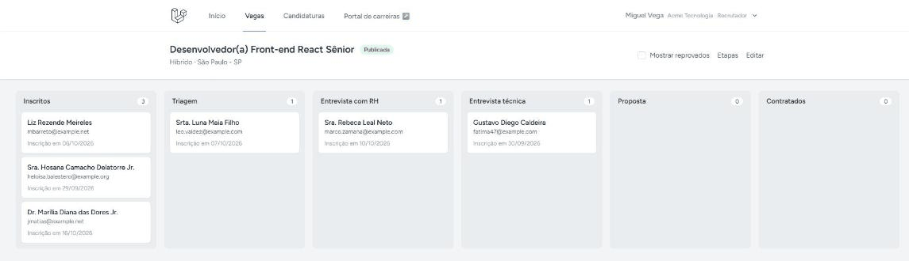
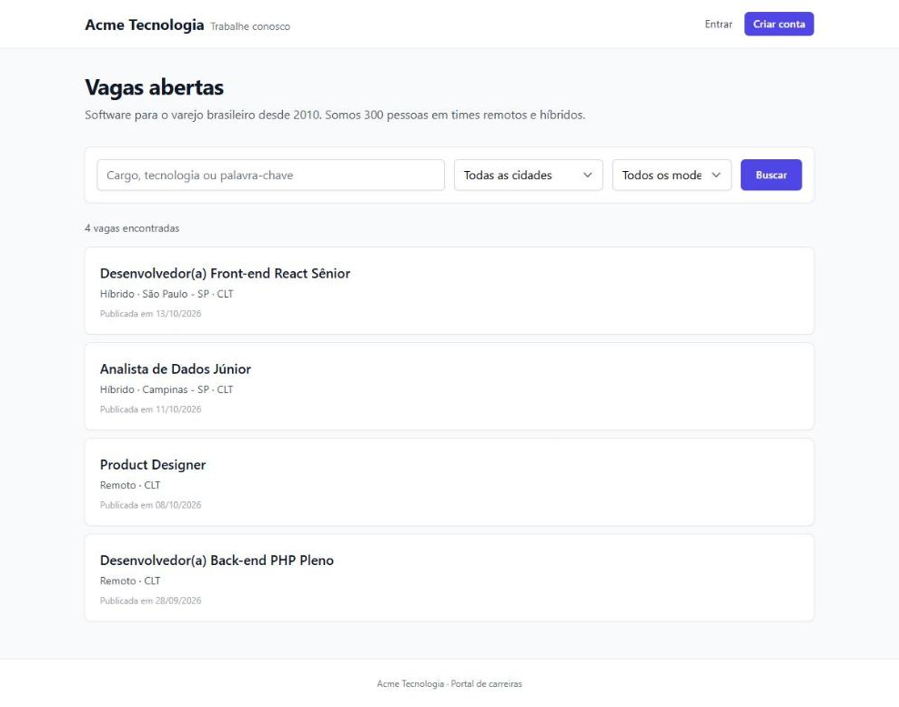
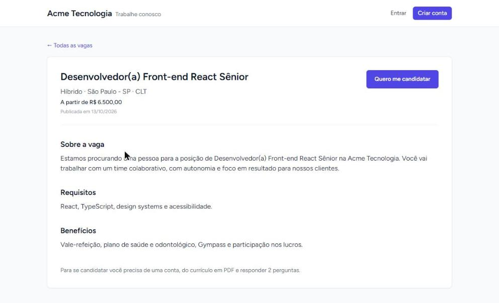
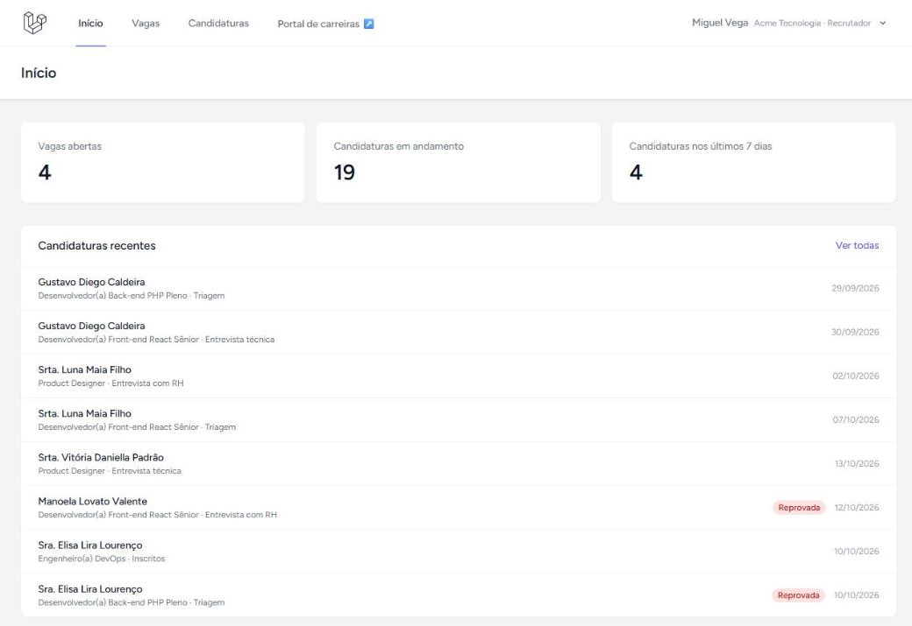
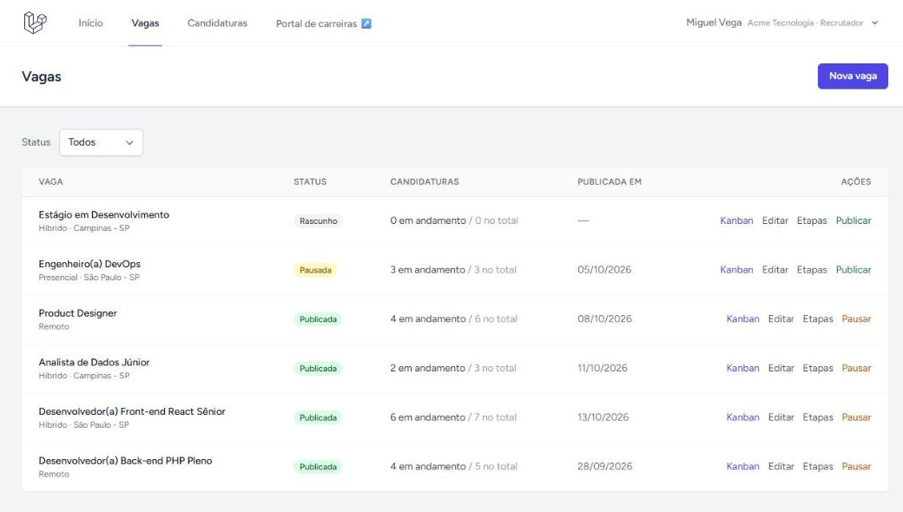
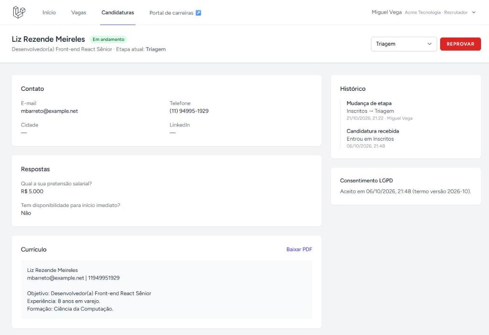
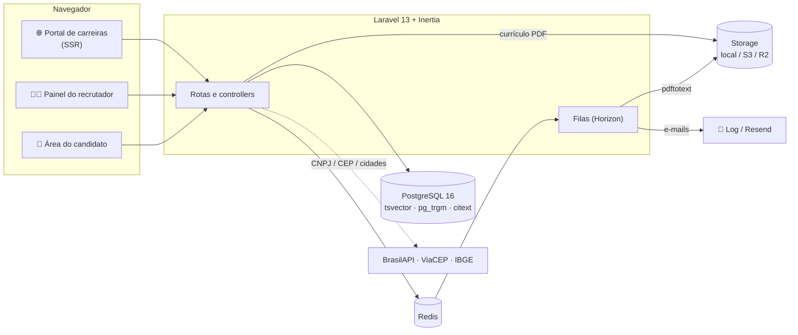
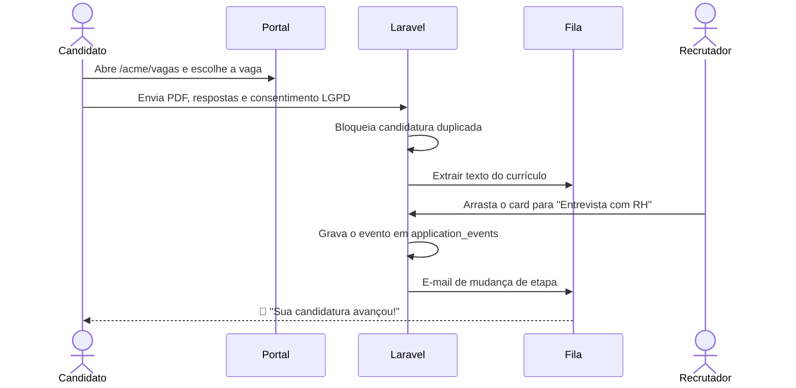
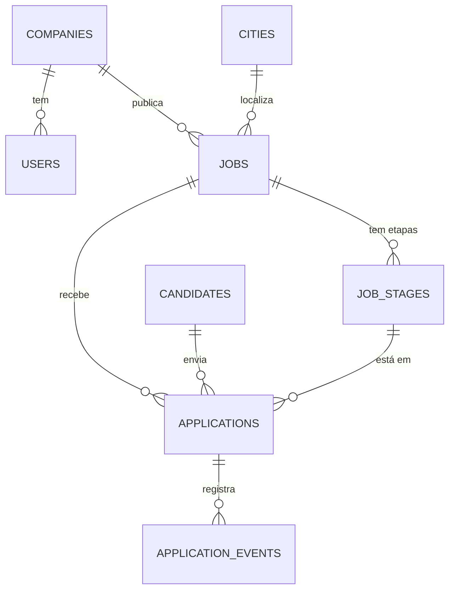

<div align="center">


<a href="#-demonstração">
  
</a>

<br/>


<br/><br/>

<a href="#-sobre">Sobre</a> •
<a href="#-demonstração">Demonstração</a> •
<a href="#-funcionalidades">Funcionalidades</a> •
<a href="#-arquitetura">Arquitetura</a> •
<a href="#-como-rodar">Como rodar</a> •
<a href="#-testes">Testes</a> •
<a href="#-próximos-passos">Próximos passos</a>

</div>

---

## 💼 Sobre

**Recrutamento** é um ATS (*Applicant Tracking System*) multiempresa feito do zero em Laravel. Cada empresa ganha um portal de carreiras próprio, o candidato se inscreve com currículo em PDF, e o time de RH acompanha cada pessoa num kanban de etapas, do "Inscritos" até o "Contratados".

O projeto nasceu como estudo de um clone da Gupy: mesma ideia, código próprio, foco em boas práticas de Laravel, PostgreSQL e testes.

> [!NOTE]
> Projeto de estudo, sem nenhum vínculo com a Gupy.

---

## 🎬 Demonstração

<div align="center">

**Arrastando uma candidatura de "Inscritos" para "Triagem"**



<sub>Cada movimento grava um evento no histórico da candidatura e envia um e-mail ao candidato pela fila.</sub>

</div>

### 🖼️ Telas

<table>
  <tr>
    <td width="50%" align="center">
      <br/>
      <b>Portal de carreiras</b><br/><sub><code>/acme/vagas</code>, com busca por texto, cidade e modelo de trabalho</sub>
    </td>
    <td width="50%" align="center">
      <br/>
      <b>Página da vaga</b><br/><sub>Descrição, requisitos, benefícios e o botão "Quero me candidatar"</sub>
    </td>
  </tr>
  <tr>
    <td width="50%" align="center">
      <br/>
      <b>Painel do recrutador</b><br/><sub>Vagas abertas, candidaturas em andamento e as mais recentes</sub>
    </td>
    <td width="50%" align="center">
      <br/>
      <b>Gestão de vagas</b><br/><sub>Rascunho, publicada ou pausada, com atalhos para kanban e etapas</sub>
    </td>
  </tr>
  <tr>
    <td colspan="2" align="center">
      <br/>
      <b>Detalhe da candidatura</b><br/><sub>Respostas, texto extraído do currículo, histórico de etapas e o consentimento LGPD registrado com data</sub>
    </td>
  </tr>
</table>

---

## ✨ Funcionalidades

<table>
  <tr>
    <td valign="top" width="33%">

### 🏢 Para a empresa
- Cadastro com **CNPJ**: os dados chegam preenchidos pela BrasilAPI
- Endereço automático pelo **CEP** (ViaCEP)
- Papéis de usuário: **admin**, **recrutador** e **gestor**
- Portal de carreiras próprio em `/{slug}/vagas`

</td>
    <td valign="top" width="33%">

### 🧑‍💼 Para o recrutador
- Cria, edita, **publica** e **pausa** vagas
- Etapas padrão em toda vaga nova, todas editáveis
- **Kanban com arrastar e soltar**
- Reprova e reativa candidaturas
- Histórico completo de cada movimento

</td>
    <td valign="top" width="33%">

### 🙋 Para o candidato
- Uma conta só para se candidatar em **várias empresas**
- Upload de currículo em **PDF** e perguntas da vaga
- Candidatura duplicada é bloqueada
- Acompanha as próprias candidaturas
- **Exclui ou anonimiza** a conta (LGPD)

</td>
  </tr>
</table>

**Por baixo do capô:**

| | |
|---|---|
| 🔒 **Multiempresa de verdade** | Toda tabela de negócio tem `company_id`; a trait `BelongsToCompany` aplica um global scope e as Policies fecham o resto. Um teste garante que uma empresa não enxerga dados de outra. |
| 🔎 **Busca sem Elasticsearch** | Coluna `tsvector` gerada em português com índice GIN, mais `pg_trgm` para buscas por trecho. |
| 📄 **Leitura do currículo** | Um job na fila roda o `pdftotext` e guarda o texto do PDF na candidatura. |
| ✉️ **E-mails em fila** | Mudança de etapa e reprovação avisam o candidato. Driver `log` em dev, Resend em produção. |
| ☁️ **Arquivos onde você quiser** | Disco local em dev; S3 ou Cloudflare R2 em produção. |
| ⚡ **Rápido e leve** | Portal renderizado com SSR, listas com paginação por cursor e `preventLazyLoading` ativo fora de produção. |
| 🗺️ **Cidades do IBGE** | Os 5.571 municípios são importados uma vez para uma tabela local. |

---

## 🏗️ Arquitetura



### Jornada de uma candidatura



### Modelo de dados



**Etapas padrão de toda vaga nova:** `Inscritos` → `Triagem` → `Entrevista com RH` → `Entrevista técnica` → `Proposta` → `Contratados`

---

## 🧰 Stack

<div align="center">


</div>

| Camada | Tecnologias |
|---|---|
| **Back-end** | Laravel 13, PHP 8.3, Laravel Horizon, Pest 4 |
| **Front-end** | Inertia 2, React 18, Tailwind CSS, dnd-kit, Ziggy |
| **Dados** | PostgreSQL 16 (`pg_trgm`, `citext`, `tsvector`), Redis 7 |
| **Integrações** | BrasilAPI (CNPJ), ViaCEP, IBGE Localidades, Resend, S3/R2 |

---

## 🚀 Como rodar

### Pré-requisitos

- PHP 8.3 e Composer
- Node.js e npm
- Docker (para o PostgreSQL e o Redis)
- `pdftotext` (opcional, para ler o texto dos currículos; vem no Poppler ou no Xpdf)

### Passo a passo

```bash
# 1. Clone o projeto
git clone https://github.com/cloudhadock-coder/Recrutamento-Clonegupy.git
cd Recrutamento-Clonegupy

# 2. Instale as dependências
composer install
npm install

# 3. Configure o ambiente
cp .env.example .env
php artisan key:generate

# 4. Suba o PostgreSQL e o Redis
docker compose up -d

# 5. Crie o schema com os dados de exemplo (inclui a importação das cidades do IBGE)
php artisan migrate --seed

# 6. Compile o front-end (cliente + SSR)
npm run build

# 7. Rode a aplicação
php artisan dev
```

Abra **http://localhost:8000** 🎉

> [!TIP]
> As filas rodam no Redis. Para os e-mails saírem e os currículos serem lidos, deixe o `php artisan horizon` rodando. Em dev, os e-mails aparecem em `storage/logs/laravel.log`.

### 🔑 Contas de demonstração

Todas usam a senha **`password`**.

| Perfil | Onde entrar | E-mail |
|---|---|---|
| 👑 Admin da Acme | `/login` | `admin@acme.test` |
| 🧑‍💼 Recrutador da Acme | `/login` | `recrutador@acme.test` |
| 📊 Gestor da Acme | `/login` | `gestor@acme.test` |
| 🏪 Recrutador do Bom Preço | `/login` | `recrutador@bompreco.test` |
| 🙋 Candidata | `/candidato/entrar` | `candidata@example.com` |

Portais públicos: **`/acme/vagas`** e **`/bompreco/vagas`**.

---

## 🧪 Testes

Os testes usam Pest e um banco PostgreSQL separado, o `recrutamento_test`. Crie esse banco uma vez:

```bash
docker compose exec pgsql createdb -U recrutamento recrutamento_test
```

Depois é só rodar:

```bash
php artisan test --compact
```

```
Tests:    1 skipped, 91 passed (321 assertions)
```

O que a suíte cobre:

- 🔒 **Isolamento entre empresas**: um recrutador não abre vaga nem candidatura de outra empresa
- 🚫 **Candidatura duplicada**: bloqueada no controller e também por constraint `unique` no banco
- 🔀 **Mudança de etapa**: grava o evento e coloca o e-mail na fila
- 🧹 **LGPD**: exclusão e anonimização da conta do candidato
- 🧾 **CNPJ**: validação e consulta na BrasilAPI
- 📄 **Currículo**: extração do texto do PDF (pulada se o `pdftotext` não estiver instalado)

---

## 📂 Estrutura

```
app/
├── Http/Controllers/
│   ├── Panel/       # painel do recrutador: vagas, etapas, candidaturas, kanban
│   ├── Portal/      # portal de carreiras público e fluxo de candidatura
│   └── Candidate/   # login, conta e candidaturas do candidato
├── Models/Concerns/BelongsToCompany.php   # global scope multiempresa
├── Policies/        # JobPolicy, ApplicationPolicy
├── Services/        # ApplicationPipeline, CandidateAccountEraser, BrasilApi, ViaCep, IBGE
├── Jobs/            # ExtractResumeText
└── Mail/            # ApplicationStageChanged, ApplicationRejected
resources/js/Pages/
├── Panel/           # Jobs (Index, Form, Kanban, Stages), Applications
├── Portal/          # Index, Show, Apply
└── Candidate/       # Login, Register, Applications, Account
```

---

## 🛣️ Próximos passos

Ideias que ficaram fora do MVP:

- [ ] 🤖 Triagem de currículos com IA (pgvector)
- [ ] 🧠 Testes comportamentais
- [ ] 📝 Admissão digital
- [ ] 📅 Agendamento de entrevistas com Google Calendar
- [ ] 🚄 Laravel Octane

---

<div align="center">

Feito com ☕ e muito `php artisan` por [@cloudhadock-coder](https://github.com/cloudhadock-coder)


</div>
